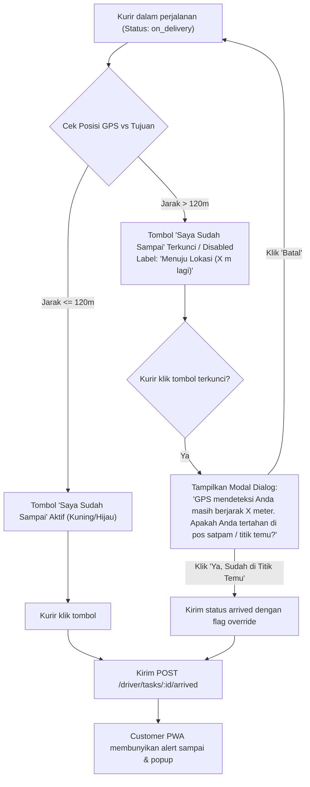

# XENTRA — Driver Arrival Geofence Specification & Activation Guide

**Status:** PENDING ACTIVATION (Deferred during active driver flow testing)  
**Date:** 2026-10-29  
**Target Modules:** `apps/driver-app/`, `server/routes/driver.js`, `apps/customer-pwa/`

---

## 1. Latar Belakang & Masalah
Saat ini, kurir di halaman peta pengantaran (`apps/driver-app/assets/js/driver-app.js`) dapat menekan tombol **"🔔 Saya Sudah Sampai di Lokasi"** kapan saja tanpa batasan jarak.
- **Dampak jika ditekan prematur:** Pelanggan di Customer PWA langsung menerima popup alert dan suara bel kedatangan (*"Kurir sudah tiba di titik pengantaran"*) padahal kurir masih jauh di perjalanan.
- **Tujuan fitur:** Mencegah penekanan tombol secara tidak sengaja / terlalu dini sebelum kurir mendekati titik tujuan, sekaligus menyediakan toleransi lapangan jika kurir tertahan di gerbang satpam komplek atau gang sempit.

---

## 2. Parameter Geofence yang Direkomendasikan

| Parameter | Nilai Default | Rasionalisasi & Perilaku Lapangan |
| :--- | :--- | :--- |
| `GEOFENCE_ARRIVAL_RADIUS_METERS` | **120 meter** (toleransi 100–150m) | Jarak lurus GPS (Haversine) antara posisi kurir dan koordinat tujuan customer. Menghindari kurir terkunci (*stuck*) jika jalanan berupa gang buntu, pagar perumahan cluster, atau titik pin customer sedikit bergeser dari gerbang. |
| `GPS_ACCURACY_THRESHOLD` | **≤ 80 meter** | Jika sinyal GPS kurir kurang akurat (*accuracy > 80m* akibat cuaca / pantulan gedung), toleransi radius otomatis ditambah sebesar nilai akurasi GPS tersebut. |
| `MANUAL_OVERRIDE_ENABLED` | **true** | Jika kurir berjarak > 120m tetapi memang sudah tiba di titik temu (misal pos satpam / lobby kantor yang melarang kurir masuk), kurir dapat melakukan konfirmasi manual melalui popup konfirmasi darurat. |

---

## 3. Alur Kerja (User Flow) Saat Diaktifkan



---

## 4. Rincian Teknis Implementasi (Checklist Saat Siap Diterapkan)

### A. Frontend: `apps/driver-app/assets/js/driver-app.js`
1. **Fungsi Haversine Distance:**
   Gunakan rumus standar jarak koordinat:
   ```javascript
   function calcDistanceMeters(lat1, lon1, lat2, lon2) {
     if (!lat1 || !lon1 || !lat2 || !lon2) return Infinity;
     var R = 6371000; // Radius bumi dalam meter
     var dLat = (lat2 - lat1) * Math.PI / 180;
     var dLon = (lon2 - lon1) * Math.PI / 180;
     var a = Math.sin(dLat / 2) * Math.sin(dLat / 2) +
             Math.cos(lat1 * Math.PI / 180) * Math.cos(lat2 * Math.PI / 180) *
             Math.sin(dLon / 2) * Math.sin(dLon / 2);
     return R * 2 * Math.atan2(Math.sqrt(a), Math.sqrt(1 - a));
   }
   ```
2. **Pengecekan di `renderMap()` (Line ~905):**
   - Hitung jarak antara `mapState.currentPosition` dengan `task.destination`.
   - Jika jarak > 120 meter:
     - Tampilkan tombol dalam kondisi sekunder atau beri indikator jarak: `🔔 Sampai di Lokasi (~X meter lagi)`.
   - Saat kurir mengklik di luar radius, trigger modal konfirmasi pos satpam / titik temu sebelum menembak API.

### B. Backend: `server/routes/driver.js`
1. **Endpoint `POST /driver/tasks/:orderId/arrived` (Line ~498):**
   - Menerima payload optional `{ latitude, longitude, override_gate: boolean }`.
   - Validasi selisih jarak jika koordinat dikirimkan.
   - Catat log geofence ke kolom audit/history jika kurir menggunakan override gerbang luar.

---

## 5. Hubungan dengan Customer PWA
Customer PWA di [`apps/customer-pwa/assets/js/pages/order-received.js`](file:///home/ubuntu/xentra-core/apps/customer-pwa/assets/js/pages/order-received.js#L238-L241) saat ini sudah memiliki dua pendeteksi:
1. `driverClickedArrived`: dipicu saat `delivery.arrived_at` terisi.
2. `gpsArrived`: otomatis berbunyi jika live GPS kurir terdeteksi `distMeters <= 35m`.

Ketika pembatasan di sisi Driver diaktifkan, kedua mekanisme ini akan bersinergi tanpa konflik.
