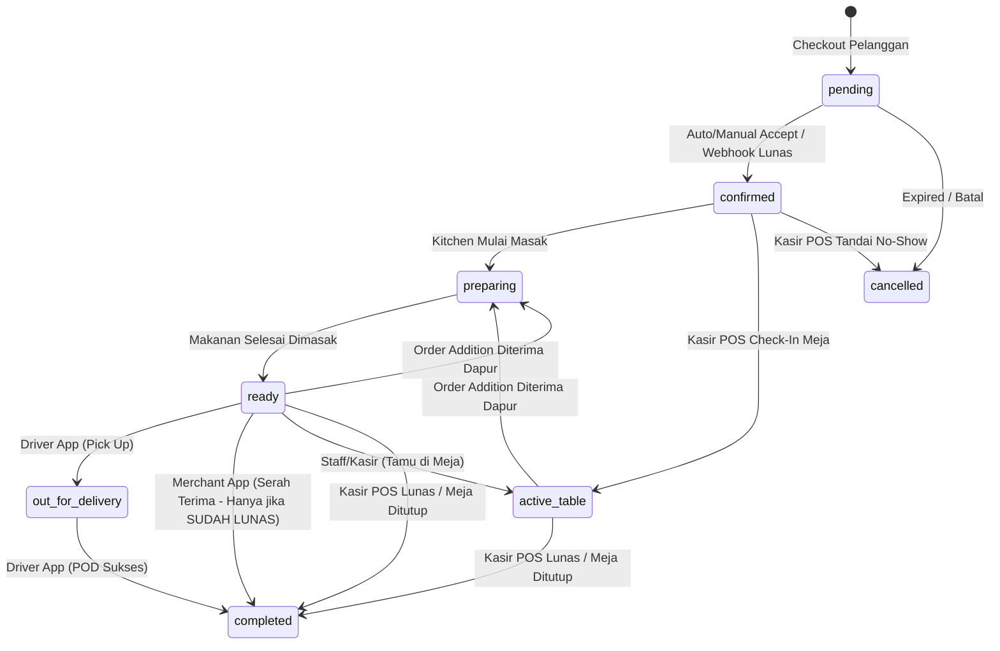

# KONTRAK ARSITEKTUR: SIKLUS HIDUP PESANAN & PEMISAHAN PERAN (ORDER LIFECYCLE & ROLE CONTRACT)
**Status:** DITETAPKAN & TERKUNCI (LOCKED ARCHITECTURAL DECISION)  
**Tanggal Penetapan:** 31 Oktober 2026  
**Referensi SaaS Acuan:** Gojek, Grab, Toast POS, Moka POS  
**Target:** Customer PWA, Merchant App, Driver App, POS Cashier App, Backend Services (`server/routes`, `domains/commerce`, `domains/dining`, `domains/pos`, `domains/payment`)

---

## 1. TUJUAN & LATAR BELAKANG
Dokumen ini dibuat berdasarkan persetujuan arsitektur eksplisit dari Product Owner guna mencegah kesalahpahaman logika (false logic), pencampuran peran (role confusion), dan tambal sulam parsial di masa depan oleh tim pengembang atau AI coding agent lainnya.

Sistem Xentra memiliki **4 Aktor / Permukaan (Surfaces)** yang terpisah secara tegas:
1. **Customer PWA (`apps/customer-app`):** Pelanggan memesan (`delivery`, `pickup`, `dine_in`, `reservation`), memilih metode bayar, memantau pelacakan live, dan melakukan pesanan tambahan (*additions*).
2. **Merchant App (`apps/merchant-app`):** Kitchen & Store Manager memantau antrean masak, menerima/menolak pesanan, memasak (`preparing` $\to$ `ready`), menugaskan kurir internal cabang terdaftar, dan menyerahkan ke kurir/tamu. **MERCHANT BUKAN KASIR DAN BUKAN DRIVER.**
3. **Driver App (`apps/driver-app`):** Kurir internal cabang menerima tugas, mengambil pesanan dari resto (`out_for_delivery`), mengantar ke pelanggan, menagih COD + mengambil foto POD, dan menyetorkan fisik uang COD ke kasir cabang. **DRIVER ADALAH SATU-SATUNYA PIHAK YANG BERHAK MENYELESAIKAN PENGANTARAN DELIVERY.**
4. **POS Cashier App (`apps/pos-app`):** Kasir cabang mengelola kas shift, menerima pembayaran langsung (*walk-in*, *dine-in split-bill*, *pickup pay-at-counter*), melakukan validasi & settlement serah terima uang COD dari driver, serta melakukan Check-In / No-Show reservasi meja tamu. **KASIR ADALAH PEMEGANG OTORITAS TUNGGAL FISIK UANG DAN MEJA.**

---

## 2. LIMA KEPUTUSAN ARSITEKTURAL TERKUNCI (LOCKED DECISIONS)

### KEPUTUSAN 1: DELIVERY (PENGANTARAN)
- **Penghapusan Kurir Non-Aplikasi:** Seluruh pesanan delivery wajib ditugaskan ke driver internal cabang yang terdaftar di sistem (`driver_id` wajib). Opsi input manual nama kurir lepas tanpa akun aplikasi telah dihapus permanen untuk menjamin akuntabilitas GPS, POD, dan uang COD.
- **Batas Tanggung Jawab Merchant:** Tanggung jawab operasional merchant berhenti saat pesanan berstatus `ready` dan `driver_id` telah ditetapkan. Merchant **TIDAK MEMILIKI TOMBOL "SELESAIKAN PENGANTARAN"** ataupun "Mulai Antar".
- **Eksekusi Pengantaran Tunggal oleh Driver:** Hanya Driver App yang berhak mengubah status `ready` $\to$ `out_for_delivery` $\to$ `completed` (wajib unggah POD atau alasan bypass valid).
- **Settlement COD:** Jika metode bayar adalah Cash On Delivery (COD), saat driver menyelesaikan pesanan (`completed`), fisik uang berada dalam penguasaan driver (`cod_cash_custody = 'driver'`). Driver wajib datang ke kasir cabang, kasir melakukan scan QR / input nomor pesanan di POS (`POST /pos/orders/:id/cod-handover`), dan uang masuk ke shift kasir (`cod_cash_custody = 'cashier'`).

### KEPUTUSAN 2: PICKUP / TAKEAWAY & DINE-IN
- **Pickup / Takeaway ("Pay First, Handover Last"):**
  - Jika pelanggan memilih bayar tunai / di kasir saat checkout pickup, pesanan berstatus `ready` namun `payment_status = 'pending'`.
  - Merchant App menampilkan lencana `⏳ Menunggu Bayar di Kasir` dan tombol serah terima **dikunci**.
  - Pelanggan membayar di Kasir POS $\to$ Kasir melunasi (`POST /pos/orders/:id/settle-cash` atau check payment) $\to$ `payment_status = 'settlement'` $\to$ Tombol serah terima merchant aktif dan dapat diserahkan ke pelanggan (`completed`).
- **Dine-In ("Serve First, Settle Anytime"):**
  - Makanan yang sudah masak wajib segera disajikan ke meja agar tidak dingin (`ready` $\to$ klik "Sajikan ke Meja" pada Merchant App).
  - Jika pesanan belum dibayar, pesanan **TIDAK DIBUAT `completed`**, melainkan tetap pada status operasional `ready` dengan catatan riwayat `[SERVED_TO_TABLE]`.
  - Kasir POS dapat membuka tagihan kapan saja untuk pembayaran tunai, QRIS statis, split-bill, atau bill grup.
  - Saat kasir melunasi seluruh tagihan atau meja ditutup (*session closed*), pesanan dine-in otomatis berubah menjadi `completed`.

### KEPUTUSAN 3: GATEWAY PEMBAYARAN ONLINE (MIDTRANS & DOKU)
- **Anti-Food Waste Gate:** Untuk pesanan dengan metode pembayaran online gateway, Merchant Dapur dilarang memasak sebelum dana pelanggan diverifikasi berhasil (`payment_status === 'settlement'`).
- Endpoint penerimaan cabang (`POST /orders/:id/branch-acceptance`) memverifikasi pembayaran. Jika belum lunas, backend menolak dengan error `PAYMENT_PENDING`.
- Merchant UI menampilkan lencana `⏳ Menunggu Pembayaran Online Pelanggan`.

### KEPUTUSAN 4: PESANAN TAMBAHAN DINE-IN (ORDER ADDITIONS)
- Pelanggan di meja dapat memesan menu tambahan (*additions*) selama sesi meja berlangsung (`OrderAdditionService`).
- Status pesanan induk yang diizinkan untuk menerima pesanan tambahan meliputi `confirmed`, `preparing`, `ready`, `active_table`, dan `completed`.
- Saat dapur menerima pesanan tambahan:
  1. Status pesanan induk otomatis di-reset menjadi `preparing` agar dapur memasak menu tambahan.
  2. `payment_status` induk diubah menjadi `pending` jika ada penambahan total tagihan yang belum lunas.
  3. Riwayat status mencatat `[ADDITION_ACCEPTED] Batch: <batch_id>`.
- **Pencegahan Double Stock Deduction:** Item pesanan tambahan yang sudah dipotong stoknya pada saat dapur menerima penambahan (`addition_batch_id IS NOT NULL`) **dikecualikan** dari pemotongan stok ulang saat pesanan induk dilunasi kasir di `OrderPlacementService.deductStockForSettledOrder()`.

### KEPUTUSAN 5: RESERVASI MEJA (RESERVATION)
- **Eksekutor Tunggal Kedatangan:** Kasir POS adalah eksekutor operasional saat tamu reservasi tiba di restoran.
- Kasir menggunakan fitur **Buku Reservasi** di POS (`GET /pos/reservations`) untuk:
  1. **Check-In:** Memilih meja yang kosong/tersedia $\to$ panggil `POST /pos/reservations/:id/check-in` dengan `{ table_number }`. Pesanan otomatis beralih tipe menjadi `dine_in`, status menjadi `active_table`, dan sesi meja dibuka.
  2. **No-Show:** Jika tamu tidak hadir melampaui batas waktu toleransi, kasir membatalkan via `POST /pos/reservations/:id/no-show`.
- **Merchant App Read-Only:** Merchant App hanya menampilkan reservasi sebagai jadwal mendatang yang bersifat informatif (*read-only*), tanpa tombol check-in atau selesai manual.

---

## 3. MATRIKS STATUS DAN TRANSISI (STATE MACHINE MATRIX)

### State Machine `OrderStateMachine.js`:

---

## 4. MATRIKS OTORITAS ROLE (ROLE BOUNDARY CONTRACT)

| Operasi Bisnis | Customer PWA | Merchant App | Driver App | POS Cashier App |
| :--- | :---: | :---: | :---: | :---: |
| **Checkout & Submit Order** | ✅ Ya | ❌ Dilarang | ❌ Dilarang | ✅ Ya (Walk-in) |
| **Terima Dapur (Kitchen Accept)** | ❌ Dilarang | ✅ Ya (Dapur) | ❌ Dilarang | ❌ Dilarang |
| **Tugaskan Driver Internal** | ❌ Dilarang | ✅ Ya (Pilih Driver) | ❌ Dilarang | ❌ Dilarang |
| **Mulai Antar (Pickup Task)** | ❌ Dilarang | ❌ Dilarang | ✅ Ya (Driver App) | ❌ Dilarang |
| **Selesaikan Antar (POD / COD)** | ❌ Dilarang | ❌ Dilarang | ✅ Ya (Driver App) | ❌ Dilarang |
| **Serah Terima Pickup** | ❌ Dilarang | ✅ Ya (Jika Lunas) | ❌ Dilarang | ❌ Dilarang |
| **Terima Kas / Tunai Kasir** | ❌ Dilarang | ❌ Dilarang | ❌ Dilarang | ✅ Ya (Otoritas Kasir) |
| **Validasi Setoran COD Driver** | ❌ Dilarang | ❌ Dilarang | ❌ Dilarang | ✅ Ya (`cod-handover`) |
| **Split Bill / Group Bill** | ❌ Dilarang | ❌ Dilarang | ❌ Dilarang | ✅ Ya (POS Checks) |
| **Check-In Reservasi Tamu** | ❌ Dilarang | ❌ Dilarang (Read-only) | ❌ Dilarang | ✅ Ya (Buku Reservasi) |
| **Tandai No-Show Reservasi** | ❌ Dilarang | ❌ Dilarang (Read-only) | ❌ Dilarang | ✅ Ya (Buku Reservasi) |
| **Buka / Tutup Sesi Meja** | ❌ Dilarang | ❌ Dilarang | ❌ Dilarang | ✅ Ya (Meja Dine-in) |

---

## 5. LARANGAN KERAS & ANTI-PATTERNS (FORBIDDEN RULES)

1. **DILARANG** menambahkan tombol "Selesaikan Pengantaran", "Antar Sekarang", atau status override delivery di Merchant App. Merchant tidak berada di jalan raya dan tidak memegang fisik paket saat pengantaran.
2. **DILARANG** memperbolehkan input teks bebas nama kurir tanpa akun terdaftar di sistem. Seluruh delivery wajib terikat ke `users.id` driver cabang aktif.
3. **DILARANG** menyelesaikan pesanan `pickup` sebelum `payment_status === 'settlement'`. Jika belum dibayar, tombol wajib non-aktif dan bertuliskan `Menunggu Bayar di Kasir`.
4. **DILARANG** menandai pesanan `dine_in` sebagai `completed` saat makanan disajikan ke meja jika pelanggan belum membayar di kasir. Makanan disajikan tetap dalam status `ready` dengan log `[SERVED_TO_TABLE]` agar kasir leluasa melakukan split-bill dan pembayaran fleksibel.
5. **DILARANG** memotong stok bahan dua kali untuk item pesanan tambahan (`addition_batch_id IS NOT NULL`) pada saat pelunasan tagihan induk.
6. **DILARANG** melakukan mutasi status reservasi di Merchant App. Merchant hanya melihat daftar reservasi untuk kesiapan bahan dan staf. Eksekusi kedatangan tamu mutlak berada di Kasir POS.
7. **DILARANG** memalsukan verifikasi setoran COD di sisi Driver App tanpa adanya rekonsiliasi database dari Kasir POS (`cod_collection_status === 'handed_over'` atau `cod_cash_custody === 'cashier'`).

---

Dokumen ini menjadi rujukan tetap pengembangan antarmuka dan backend sistem pesanan Xentra. Setiap perubahan terhadap aturan ini wajib melalui persetujuan tertulis Product Owner.
