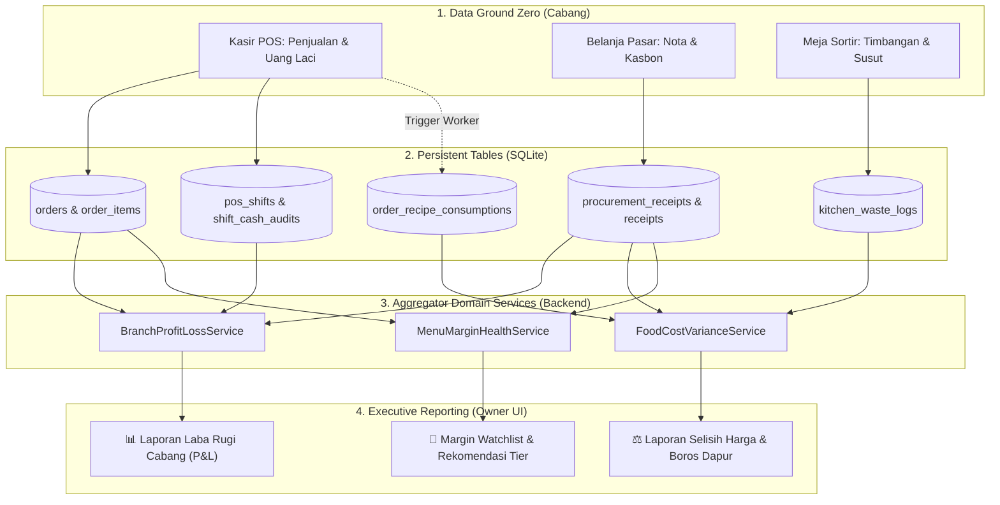

# Xentra Owner Financial & Food Cost Variance Reporting Specification

**Dokumen Rujukan:** Spesifikasi Teknis & Rencana Implementasi Modul Laporan Owner  
**Status:** 🔒 APPROVED SPECIFICATION / READY FOR IMPLEMENTATION  
**Tanggal Dokumen:** 28 Oktober 2026  
**Target Permukaan:** Owner Mobile App (`apps/owner-app/`), Merchant Dashboard Web (`apps/merchant-dashboard/`), dan Reporting Core (`domains/reporting/`, `server/routes/admin-reporting.js`)  
**Penulis:** Tim Engineering Xentra

---

## 1. Latar Belakang & Tujuan Bisnis

Sistem operasional cabang telah berhasil menangkap data dasar secara akurat:
1. **Penjualan Kasir POS**: Transaksi pesanan tunai, QRIS, dan per-channel terdata rapi via [`SalesReportService.js`](file:///home/ubuntu/xentra-core/domains/reporting/services/SalesReportService.js).
2. **Belanja Pasar Lokal**: Pembelian bahan mentah (beras, telur, cabai) tercatat dengan harga riil via `ProcurementService`.
3. **Resep Baku Pusat (BoM)**: Pengurangan stok teoritis terhitung otomatis saat kasir memproses pesanan via [`RecipeConsumptionWorker.js`](file:///home/ubuntu/xentra-core/domains/inventory/workers/RecipeConsumptionWorker.js).
4. **Sortir Fisik Dapur**: Timbangan riil dan catatan susut (misal 8 butir telur retak) tercatat di modul QC.

### Masalah yang Diselesaikan:
Saat ini data-data di atas masih terisolasi di tabel masing-masing. Owner belum memiliki **satu layar eksekutif terpadu** untuk menjawab:
* *"Bulan ini Cabang Pringsewu untung bersih berapa setelah dipotong belanja pasar?"*
* *"Berapa uang tunai yang wajib disetor kasir ke rekening Owner hari ini?"*
* *"Apakah chef dapur boros bahan melebihi resep pusat?"*
* *"Menu mana yang marginnya sedang jebol akibat inflasi harga pasar lokal?"*

Dokumen ini menjadi cetak biru (*blueprint*) pembuatan sistem pelaporan finansial khusus untuk **Aplikasi Owner**.

---

## 2. Arsitektur Aliran Data (Data Flow Architecture)



---

## 3. Spesifikasi Modul 1: Laporan Laba Rugi Cabang (Branch P&L)

### A. Endpoint API Contract
* **Route:** `GET /api/v1/admin/analytics/branch-pnl`
* **Authority:** `requireAuth(['owner', 'brand_manager'])`
* **Query Parameters:**
  * `branch_id` (string, optional - default: seluruh cabang / konsolidasi)
  * `start_date` (ISO date, e.g. `2026-10-01`)
  * `end_date` (ISO date, e.g. `2026-10-28`)
  * `group_by` (`day` | `week` | `month` - default: `month`)

### B. Format Output Payload
```json
{
  "success": true,
  "data": {
    "period": { "start": "2026-10-01", "end": "2026-10-28" },
    "branch_id": "branch_pringsewu",
    "branch_name": "MyBangjo Pringsewu",
    "pnl": {
      "gross_sales": 88500000,
      "discounts": 3500000,
      "net_sales": 85000000,
      "cogs_materials": {
        "raw_materials_consumed": 35250000,
        "kitchen_waste_cost": 1200000,
        "total_cogs": 36450000,
        "cogs_percentage": 42.88
      },
      "gross_profit": 48550000,
      "gross_margin_percentage": 57.12,
      "branch_operating_expenses": {
        "daily_market_supplies": 4200000,
        "gas_and_utilities": 1800000,
        "petty_cash_misc": 800000,
        "total_opex": 6800000,
        "opex_percentage": 8.00
      },
      "branch_operating_profit_ebitda": 41750000,
      "net_margin_percentage": 49.12
    },
    "cash_settlement": {
      "bank_qris_received": 55000000,
      "cash_collected_drawer": 30000000,
      "cash_spent_market": 12000000,
      "cash_variance_drawer": 0,
      "net_cash_to_deposit": 18000000,
      "deposit_status": "PENDING_VERIFICATION"
    }
  }
}
```

---

## 4. Spesifikasi Modul 2: Laporan Kontrol & Varians (Food Cost Variance)

### A. Endpoint API Contract
* **Route:** `GET /api/v1/admin/analytics/food-cost-variance`
* **Authority:** `requireAuth(['owner', 'brand_manager'])`

### B. Matriks Dua Varians Resto
Laporan ini mengisolasi antara **masalah harga belanja** vs **masalah disiplin dapur**:

```
TOTAL FOOD COST VARIANCE = PRICE VARIANCE + USAGE VARIANCE
```

1. **Price Variance (Tanggung Jawab Staf Belanja / Pasar):**
   $$\text{Price Variance} = (\text{Harga Beli Pasar Cabang} - \text{Harga Acuan Standar Pusat}) \times \text{Kuantitas Beli}$$
   * Jika minus: Pasar lokal mengalami inflasi / staf belanja kemahalan.
   * Jika plus: Staf belanja berhasil negosiasi harga di bawah standar pusat.

2. **Usage Variance (Tanggung Jawab Chef & Tim Dapur):**
   $$\text{Usage Variance} = (\text{Kuantitas Teori Resep POS} - \text{Kuantitas Riil Terpakai}) \times \text{Harga Acuan}$$
   * Jika minus: Terjadi pemborosan takaran (*over-portioning*), bahan basi/gosong, atau susut sortir.
   * Jika nol/wajar ($<2\%$): Dapur disiplin mematuhi BoM.

### C. Format Output Payload
```json
{
  "success": true,
  "data": {
    "price_variance_items": [
      {
        "material_id": "mat_beras",
        "material_name": "Beras Ramos Premium",
        "standard_unit_cost": 10000,
        "actual_unit_cost": 8800,
        "variance_per_unit": 1200,
        "total_purchased_qty": 200,
        "total_financial_variance": 240000,
        "status": "FAVORABLE_SAVING"
      },
      {
        "material_id": "mat_cabai",
        "material_name": "Cabai Rawit Merah",
        "standard_unit_cost": 30000,
        "actual_unit_cost": 45000,
        "variance_per_unit": -15000,
        "total_purchased_qty": 30,
        "total_financial_variance": -450000,
        "status": "UNFAVORABLE_INFLATION"
      }
    ],
    "usage_variance_items": [
      {
        "material_id": "mat_ayam",
        "material_name": "Daging Ayam Karkas",
        "theoretical_qty": 240.0,
        "actual_consumed_qty": 268.0,
        "variance_qty": -28.0,
        "variance_percentage": -11.66,
        "cost_impact": -952000,
        "suspected_cause": "OVER_PORTIONING_OR_TRIMMING"
      }
    ]
  }
}
```

---

## 5. Spesifikasi Modul 3: Menu Margin Watchlist & Rekomendasi Tier

### A. Endpoint API Contract
* **Route:** `GET /api/v1/admin/analytics/menu-margin-health`
* **Authority:** `requireAuth(['owner', 'brand_manager'])`

### B. Guardrail & Sinyal Aksi (Threshold Matrix)
* **🟢 SEHAT (Margin $\ge 55\%$):** Tidak ada tindakan yang diperlukan.
* **🟡 WASPADA (Margin $45\% - 54\%$):** Sinyal monitoring komoditas.
* **🔴 KRITIS (Margin $< 45\%$):** Sistem memicu rekomendasi cerdas ke Owner:
  1. *Opsi A:* Menaikkan harga jual cabang (masih di dalam batas rentang *Mode Range* cabang).
  2. *Opsi B:* Mengalihkan pengadaan bahan ke suplier langganan pusat.
  3. *Opsi C:* Mematikan sementara menu yang merugi dari daftar PWA pemesan.

---

## 6. Perancangan UI / Mockup Layar di Owner App

Halaman baru di Owner App: **"Keuangan & Laba Rugi Cabang"** (`/#pnl`):

```
┌─────────────────────────────────────────────────────────────┐
│ 🏪 MyBangjo Pringsewu ▾   [ Periode: Oktober 2026 ▾ ] [⚙️]  │
├─────────────────────────────────────────────────────────────┤
│ 💰 LABA BERSIH OPERASIONAL (EBITDA)                         │
│ Rp 41.750.000                           Margin Bersih 49.2% │
├──────────────────────────────┬──────────────────────────────┤
│ Total Omzet Kasir            │ HPP Riil Bahan Baku          │
│ Rp 85.000.000                │ Rp 36.450.000 (42.8%)        │
├──────────────────────────────┴──────────────────────────────┤
│ 🧾 ARUS KAS FISIK & SETORAN TOKO                            │
│ • Uang Digital (QRIS/Bank): Rp 55.000.000 (Otomatis Masuk)  │
│ • Kas Fisik di Laci POS   : Rp 30.000.000                   │
│ • Pengeluaran Belanja     : (Rp 12.000.000)                 │
│ ➜ SISA KAS TUNAI WAJIB DISETOR KE OWNER: Rp 18.000.000 [✓]  │
├─────────────────────────────────────────────────────────────┤
│ ⚖️ KONTROL VARIANS & KEBOCORAN DAPUR                        │
│ • Beras Ramos  : Hemat +Rp 240.000 dari standar pusat   🟢   │
│ • Cabai Rawit  : Rugi  -Rp 450.000 akibat inflasi pasar 🔴   │
│ • Daging Ayam  : Dapur boros 28 Kg (-Rp 952.000)        ⚠️   │
│   (Peringatan: Potongan chef terindikasi di atas 120g)      │
├─────────────────────────────────────────────────────────────┤
│ 🚨 WATCHLIST MARGIN MENU TERANCAM                           │
│ [!] Ayam Geprek Super Pedas: Margin sisa 38% (Kritis)       │
│     Saran: Naikkan harga Tier Pringsewu ke Rp 20.000        │
│     [ Setujui Kenaikan ]  [ Biarkan Sementara ]             │
└─────────────────────────────────────────────────────────────┘
```

---

## 7. Rencana Pengerjaan Bertahap (Step-by-Step Implementation)

Pengerjaan modul ini dipecah menjadi **4 fase teknis terisolasi** agar tidak mengganggu transaksi POS kasir yang sedang berjalan:

### Fase 1: Backend Domain Aggregators (Estimasi: 1 Sprint)
* [ ] Buat file servis [`domains/reporting/services/BranchProfitLossService.js`](file:///home/ubuntu/xentra-core/domains/reporting/services/BranchProfitLossService.js)
  * Mengagregasikan `orders`, `pos_shifts`, dan `receipts`.
* [ ] Buat file servis [`domains/reporting/services/FoodCostVarianceService.js`](file:///home/ubuntu/xentra-core/domains/reporting/services/FoodCostVarianceService.js)
  * Menghitung Price Variance (harga nota vs harga master) dan Usage Variance (`order_recipe_consumptions` vs timbangan sisa).
* [ ] Buat file servis [`domains/reporting/services/MenuMarginHealthService.js`](file:///home/ubuntu/xentra-core/domains/reporting/services/MenuMarginHealthService.js)
  * Menghitung margin terkini per menu dari harga bahan baku belanjaan terakhir.

### Fase 2: API Route Contracts & Permissions (Estimasi: 2 Hari)
* [ ] Daftarkan route baru di [`server/routes/admin-reporting.js`](file:///home/ubuntu/xentra-core/server/routes/admin-reporting.js):
  * `GET /admin/analytics/branch-pnl`
  * `GET /admin/analytics/food-cost-variance`
  * `GET /admin/analytics/menu-margin-health`
* [ ] Pasang RBAC guard: Khusus untuk role `owner` dan `brand_manager`. Role kasir dan branch manager dilarang membaca data laba bersih holding.

### Fase 3: Automated Unit & Integration Tests (Estimasi: 2 Hari)
* [ ] Buat berkas pengujian: `tests/branchProfitLossReporting.test.js`
  * Verifikasi rumus `Omzet - HPP - Opex = EBITDA`.
  * Verifikasi rekonsiliasi kas: `QRIS + Tunai - Belanja = Kas Setor`.
* [ ] Buat berkas pengujian: `tests/foodCostVarianceReporting.test.js`
  * Verifikasi rumus Price Variance dan Usage Variance.

### Fase 4: Frontend UI Owner Dashboard & Mobile (Estimasi: 1 Sprint)
* [ ] Buat halaman baru di Owner Dashboard: `apps/merchant-dashboard/assets/js/modules/pnl-reporting.js`.
* [ ] Integrasikan ke navigasi mobile Owner App ([`apps/owner-app/`](file:///home/ubuntu/xentra-core/apps/owner-app/)).
* [ ] Tambahkan widget tombol eksekusi: *"Terapkan Kenaikan Harga Tier"* langsung dari rekomendasi margin.

---

## 8. Verifikasi & Acceptance Criteria (Definisi Selesai)

1. **Akurasi Angka:** Total laba kotor di laporan P&L harus 100% klop dengan nilai `Gross Revenue - Total COGS` transaksi kasir.
2. **Tanpa Input Manual Cabang:** Seluruh angka di laporan terisi otomatis dari aktivitas kasir POS, belanja pasar, dan QC meja sortir yang sudah ada di Merchant App.
3. **Pemisahan Hak Akses:** Kasir cabang tidak dapat melihat laporan laba rugi ini; hanya akun berwewenang Owner yang dapat mengakses.
