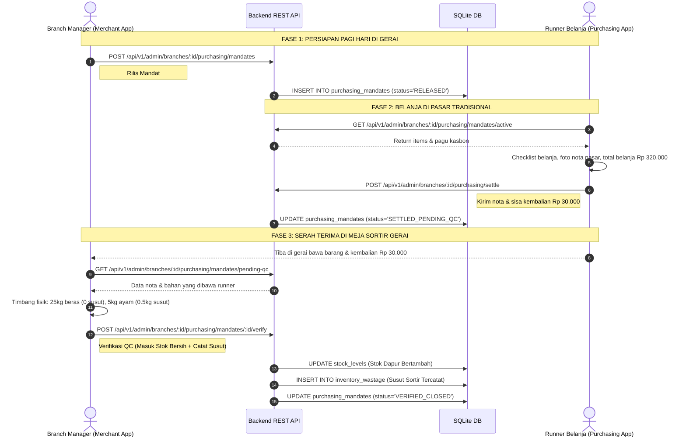

# Architecture Decision: Surface & Domain Separation (Merchant App vs Purchasing App)

**Status:** APPROVED & ENFORCED  
**Date:** 2026-10-28  
**Domain Area:** Multi-Surface Architecture, Role-Based Boundaries, Store Operations vs Field Logistics

---

## 1. Executive Context & Problem Statement

Sebelumnya, terjadi kebocoran domain (*domain leakage*) pada `apps/merchant-app/` di mana komponen antarmuka yang seharusnya menjadi tanggung jawab staf lapangan / runner pasar (seperti kalkulator pasar cepat, checklist belanja kios, dan form input belanjaan eceran) ditempel paksa ke dalam aplikasi gerai / Merchant App.

Kondisi tersebut melanggar prinsip *Separation of Concerns* (SoC) dan bertentangan dengan realitas operasional restoran:
1. **Runner Belanja** beroperasi di luar gerai (pasar tradisional, kios sayur becek, grosir) menggunakan HP pribadi dengan kondisi mobilitas tinggi.
2. **Branch Manager / Supervisor Gerai** beroperasi di dalam gerai (meja kasir / meja sortir dapur) menggunakan tablet gerai atau HP manajer untuk memastikan kelancaran pesanan tamu, operasional dapur, dan akurasi penerimaan barang masuk.
3. Menggabungkan kedua domain ini ke dalam satu aplikasi membebani UI kasir gerai (*bloatware*), membingungkan staf, dan merusak tata kelola pencatatan keuangan kasbon gerai.

---

## 2. Definisi Batasan Domain (The 4 Distinct Surfaces)

Sistem Xentra membagi arsitektur frontend menjadi 4 *execution surfaces* yang terisolasi secara environment dan runtime:

```
+-------------------------------------------------------------------------------+
|                             XENTRA ARCHITECTURE                               |
+-------------------------------------------------------------------------------+
|                                                                               |
|  [ SURFACE 1: RUNNER FIELD OPS ]           [ SURFACE 2: IN-STORE OUTLET OPS ]  |
|  App: Xentra Belanja                       App: Xentra Merchant               |
|  Path: /belanja/ (APK Runner)              Path: /merchant/ (APK Gerai)       |
|  Role: purchasing                          Role: branch_manager               |
|  Perangkat: Smartphone Runner di Pasar     Perangkat: Tablet Kasir / HP Mgr   |
|  Tugas:                                    Tugas:                             |
|  - Cek mandat belanja harian               - Rilis uang kasbon pagi           |
|  - Total Nota Pasar + Foto Karcis          - Timbang terima barang (Meja QC)  |
|  - Settle belanjaan & kembalian            - Buka/tutup menu (out-of-stock)   |
|  - Kalkulator cepat pasar                  - Kelola antrean order & KDS       |
|                                                                               |
+------------------------------------+------------------------------------------+
                                     | Shared REST API & DB
                                     v
+------------------------------------+------------------------------------------+
|  [ SURFACE 3: POINT OF SALE ]              [ SURFACE 4: HQ EXECUTIVE OPS ]    |
|  App: Xentra POS                           App: Xentra Owner                  |
|  Path: /pos/ (APK POS / Sunmi)             Path: /owner/ (Desktop/Mobile Web) |
|  Role: cashier                             Role: owner, brand_manager         |
|  Tugas: Transaksi kasir, cetak struk       Tugas: BoM Resep, Price Variance,  |
|  cepat, laci kas, closing shift.           Usage Variance, Konsolidasi P&L.   |
+-------------------------------------------------------------------------------+
```

---

## 3. Matriks Hak Akses & Larangan (Strict Boundaries)

| Fitur / Tindakan | Purchasing App (`/belanja/`) | Merchant App (`/merchant/`) | Owner App (`/owner/`) | Keterangan & Alasan |
| :--- | :---: | :---: | :---: | :--- |
| **Kalkulator Cepat Pasar** |  **WAJIB** |  **DILARANG** |  Dilarang | Hanya runner di pasar yang butuh hitung belanjaan kios. |
| **Checklist Belanja Kios** |  **WAJIB** |  **DILARANG** |  Dilarang | Kasir/manager di outlet tidak belanja ke kios pasar. |
| **Input Total Nota & Foto Struk** |  **WAJIB** |  **DILARANG** |  Dilarang | Runner yang memegang nota fisik pasar & mengambil foto. |
| **Rilis Mandat & Pagu Kasbon Pagi** |  Dilarang |  **WAJIB** |  Read-Only | Manager gerai yang memegang kas fisik brankas outlet. |
| **Timbang Terima & QC Meja Sortir** |  Dilarang |  **WAJIB** |  Read-Only | Manager/Cook menimbang fisik bersih vs susut saat runner tiba. |
| **Terima & Settle Kasbon Fisik** |  Submit |  **Verifikasi Final** |  Audit | Uang sisa kasbon diserahkan fisik runner ke kasir toko. |
| **Buka / Tutup Status Menu (86)** |  Dilarang |  **WAJIB** |  Opsi Global | Dilakukan seketika oleh kasir/manager saat stok fisik habis. |
| **POS & Pesanan Konsumen** |  Dilarang |  **WAJIB** |  Read-Only | Runner tidak boleh mengakses penjualan dan uang kasir POS. |
| **P&L Konsolidasi & Price Variance** |  Dilarang |  Dilarang |  **WAJIB** | Rahasia bisnis; cabang hanya boleh melihat omzet shift. |

---

## 4. Kontrak Pertukaran Data (*Shared Data Layer*)

Kedua aplikasi tidak pernah saling mengimpor file JavaScript atau CSS antarmuka. Keduanya hanya berinteraksi melalui **Backend REST API**:



---

## 5. Implementasi & Standardisasi UI

### A. Pada `apps/purchasing-app/` (APK Runner)
1. Form input belanja pasar menerapkan prinsip: **[Kuantitas Diterima] + [Total Nominal Nota] + [Foto Nota]**.
2. Sistem otomatis menghitung harga satuan riil tanpa membebani kalkulasi mental runner.
3. Aplikasi bersifat mandiri (*standalone PWA/APK*) dengan scope `/belanja/`.

### B. Pada `apps/merchant-app/` (APK Gerai)
1. **Dibersihkan total** dari:
   - Header purchasing `#purchasing-mobile-topbar`.
   - Bottom navigation purchasing `#purchasing-bottom-nav`.
   - Modul kalkulator pasar cepat `#purchasing-view-calc`.
   - Form checklist belanja kios runner `#purchasing-view-tasks`.
2. **Difokuskan murni** pada:
   - **Mandat Kasbon Harian**: Melepas uang belanja pagi hari ke runner.
   - **Penerimaan Barang & QC Meja Sortir**: Menimbang fisik barang saat runner tiba, mencatat susut bersih/kotor, dan mengkonfirmasi penerimaan stok ke dapur.
