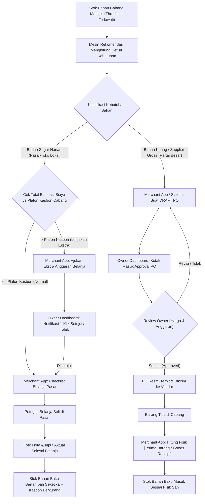

# Xentra — Procurement Governance & Dual-Track Approval Architecture Contract v1

**Status:** 🔒 LOCKED DECISION & ARCHITECTURE BLUEPRINT  
**Date:** 2026-10-16  
**Domain:** Inventory, Procurement, Governance, Multi-Branch F&B Operations  
**Surfaces:** Owner Merchant Dashboard (`apps/merchant-dashboard/`), Merchant Operating App (`apps/merchant-app/`)

---

## 1. Latar Belakang & Prinsip Tata Kelola (Governance Principle)

Dalam operasional bisnis restoran dan multi-cabang F&B, terdapat dua risiko besar yang bertolak belakang:
1. **Risiko Kebuntuan Operasional (*Operational Bottleneck*):** Jika seluruh keputusan belanja bahan segar harian (cabai, telur, ayam potong, es batu) harus menunggu persetujuan (*approval*) Owner secara manual, dapur cabang akan terlambat masak dan toko terlambat buka.
2. **Risiko Kebocoran Keuangan (*Financial Fraud & Overstock*):** Jika cabang diberikan kebebasan penuh tanpa batasan untuk memesan ke supplier atau mengeluarkan uang tunai tanpa pagu anggaran, potensi mark-up harga, nota fiktif, dan pembengkakan HPP menjadi tidak terkontrol.

### Prinsip Utama:
> **"Rekomendasi kebutuhan dihitung otomatis oleh sistem dan disajikan ke Cabang. Belanja harian pasar dieksekusi langsung oleh Cabang di bawah Plafon Kasbon Harian (*Petty Cash Limit*). Belanja partai besar ke Supplier atau belanja di atas plafon WAJIB disetujui (*Approved*) oleh Owner."**

---

## 2. Pemisahan Hak Akses & Matriks Kewenangan (RACI Matrix)

| Aktivitas Pengadaan | Merchant / Cabang (Merchant App) | Owner (Merchant Dashboard) | Catatan Operasional |
| :--- | :--- | :--- | :--- |
| **Perhitungan Kebutuhan Stok** | Melihat rekomendasi bahan habis/menipis | Melihat kebutuhan konsolidasi seluruh cabang | Otomatis oleh Mesin Rekomendasi (*BOM explosion*) |
| **Belanja Harian Pasar (di bawah Plafon)** | **Eksekutor Langsung** (Bawa kasbon $\rightarrow$ Belanja $\rightarrow$ Foto Nota) | Pengawas / Auditor (Menerima rekonsiliasi kasbon) | Tidak butuh approval klik per item agar subuh dapur tidak mogok |
| **Belanja Harian Pasar (Over-Plafon)** | Pengusul (*Proposer*) | **Pengambil Keputusan (*Approver*)** | Trigger otomatis jika total belanja > plafon harian |
| **Pemesanan Supplier Resmi (PO Bahan Kering)** | Pengusul (*Draft PO*) | **Penentu & Pemilik Anggaran (*Approve & Release PO*)** | Vendor resmi ditagihkan ke rekening pusat/perusahaan |
| **Penerimaan Barang Fisik (*Goods Receipt*)** | **Pemeriksa Fisik & Saksi Terima** | Penerima Laporan Selisih (*Variance*) | Tim cabang yang menerima kurir dan menghitung fisik datang |
| **Koreksi Opname (*Adjustment*)** | Mengajukan opname selisih fisik | Melihat riwayat *waste* / *spoilage* | Hanya untuk barang jadi (*Direct Retail Goods*) |

---

## 3. Alur Kerja Dua Jalur (Dual-Track Lifecycle Specification)

---

## 4. Invarian Sistem & Aturan Backend (System Invariants)

1. **Aturan Plafon Kasbon (*Petty Cash Ceiling Rule*):**
   - Setiap cabang memiliki parameter `daily_petty_cash_limit` yang ditentukan oleh Owner.
   - Jika `sum(estimated_market_shopping) <= daily_petty_cash_limit`, aksi `EXECUTE_MARKET_SHOPPING` berstatus `ALLOWED`.
   - Jika melampaui, status berubah menjadi `REQUIRES_OWNER_APPROVAL`.
2. **Aturan Status Dokumen PO (*PO State Machine*):**
   - Transisi status Purchase Order: `DRAFT` $\rightarrow$ `APPROVED` $\rightarrow$ `ORDERED` $\rightarrow$ `PARTIALLY_RECEIVED` $\rightarrow$ `COMPLETED`.
   - Peran `branch_staff` / `purchasing` di cabang **HANYA** diizinkan membuat status `DRAFT` dan mengeksekusi `GOODS_RECEIPT`.
   - Peran `owner` / `brand_manager` memegang hak eksklusif untuk mengubah status `DRAFT` $\rightarrow$ `APPROVED` dan `APPROVED` $\rightarrow$ `ORDERED`.
3. **Pencatatan Aktual vs Rekomendasi (*Variance Immutability*):**
   - Sistem tidak boleh menimpa angka rekomendasi saat cabang menginput angka aktual yang dibeli.
   - Kedua angka disimpan berdampingan untuk audit performa belanja:
     $$\text{Variance Qty} = \text{Actual Received} - \text{Recommended Qty}$$
     $$\text{Variance Cost} = \text{Actual Cost} - \text{Estimated Cost}$$
4. **Mutasi Fisik HANYA pada Penerimaan Sah (*Physical Stock Invariant*):**
   - Saldo persediaan bahan baku di cabang **TIDAK PERNAH BERTAMBAH** saat PO disetujui.
   - Stok hanya bertambah ketika:
     a) Untuk Belanja Pasar: Transaksi `POST /api/v1/admin/purchasing/settle` berstatus sukses dengan bukti nota.
     b) Untuk Supplier PO: Transaksi `POST /api/v1/admin/inventory-workflow/purchase-orders/:id/receive` dieksekusi dengan kuantitas fisik yang diterima (*accepted quantity*).
